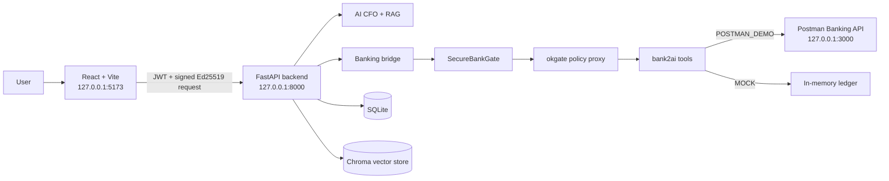
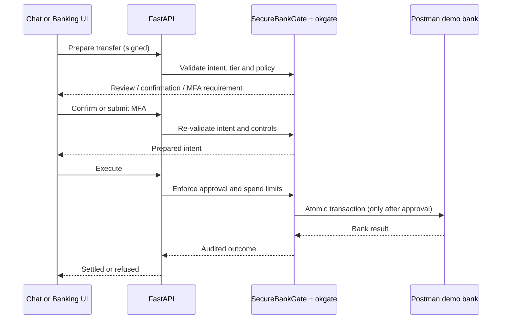

# CASHFLOW

> AI-powered financial operations for SMEs with a zero-trust banking sandbox.

[](app/)
[](front-end/)
[](banking-agent/)
[](postman-demo/)

CASHFLOW combines document analysis, financial reporting, AI CFO chat, and a
local banking sandbox. Banking actions are deliberately separated from
conversation: a chat request can create a **transfer intent**, but money is
never moved until the user completes the zero-trust controls.

> **Important:** This repository is a local development and demonstration
> system. The Postman Banking API is in-memory and is not a production bank.
> Never use the demo keys or sample data for real funds.

## Contents

- [What is included](#what-is-included)
- [Architecture](#architecture)
- [Transfer security model](#transfer-security-model)
- [Prerequisites](#prerequisites)
- [Installation](#installation)
- [Run the complete stack](#run-the-complete-stack)
- [Configure the Postman Banking API](#configure-the-postman-banking-api)
- [Use Postman](#use-postman)
- [Use the chatbot for transfers](#use-the-chatbot-for-transfers)
- [API endpoints](#api-endpoints)
- [Testing and validation](#testing-and-validation)
- [Environment variables](#environment-variables)
- [Troubleshooting](#troubleshooting)
- [Project layout](#project-layout)
- [Security notes](#security-notes)

## What is included

| Component | Purpose | Default |
|---|---|---|
| FastAPI backend | Authentication, documents, analysis, CFO chat, banking bridge | `http://127.0.0.1:8000` |
| React/Vite frontend | Dashboard, reports, chat, banking and security UI | `http://127.0.0.1:5173` |
| Banking security layer | Signed requests, tiers, MFA, approvals, kill switch and audit | Runs inside the backend |
| Postman Banking API demo | Stateful local REST bank used as the upstream sandbox | `http://127.0.0.1:3000` |
| Postman collection | Ready-to-import banking requests | `postman-demo/CASHFLOW-Banking-API.postman_collection.json` |

## Architecture



### Request boundaries

1. The browser authenticates with the FastAPI backend using JWT.
2. Banking requests are signed in the browser with an Ed25519 key held in
   IndexedDB.
3. FastAPI verifies the signature, request timestamp, client identity and
   semantic transaction ID (STID).
4. `SecureBankGate` classifies the operation and applies confirmation, MFA,
   spend, approval and kill-switch rules.
5. `okgate` enforces the upstream tool policy and writes its audit record.
6. Only then does the selected bank backend receive the request.

## Transfer security model



The chatbot accepts a transfer request such as:

```text
Transfer 25 to Alex account 123456
```

It does **not** execute from text. The user must select a source account,
review the transfer, and complete every required policy step.

| Tier | Typical condition | Required action |
|---|---|---|
| Green | Within the low-value policy | Prepare, then execute |
| Yellow | Above the confirmation threshold | Explicit confirmation |
| Red | Above the strong-verification threshold | MFA, then confirmation |
| Any tier | Tool or policy violation | Refused and audited |

The exact thresholds and caps are controlled by
[`banking-agent/okgate.yaml`](banking-agent/okgate.yaml), not by the UI.

## Prerequisites

Install these before starting:

- **Windows 10/11** (commands below use PowerShell) or an equivalent Unix
  shell
- **Python 3.11+** for `banking-agent` and the backend
- **Node.js 20+** and npm for the Postman demo and frontend
- Git
- Optional: AWS credentials for Bedrock mode
- Optional: Ollama for local AI mode

Check versions:

```powershell
python --version
node --version
npm --version
git --version
```

## Installation

Run these commands from the repository root.

### 1. Create the backend environment

```powershell
python -m venv .venv
.\.venv\Scripts\Activate.ps1
python -m pip install --upgrade pip
pip install -r requirements.txt
Copy-Item app\.env.example app\.env
```

Edit `app/.env` and set at least:

```dotenv
APP_ENV=development
DEBUG=true
SECRET_KEY=replace-with-a-long-local-secret
JWT_EXPIRATION_HOURS=24
DATABASE_URL=sqlite:///./data/cfone.db
PROCESSING_MODE=local
API_HOST=127.0.0.1
API_PORT=8000
```

Use `PROCESSING_MODE=aws` only after configuring valid Bedrock credentials and
model access. Local mode is the fastest way to verify the application.

### 2. Install the banking security layer

`bank2ai` requires Python 3.11+. The security layer also uses Node's `npx` to
run the okgate package.

```powershell
Set-Location banking-agent
python -m venv .venv
.\.venv\Scripts\Activate.ps1
python -m pip install --upgrade pip
pip install -r requirements.txt
Set-Location ..
```

### 3. Install the frontend

```powershell
Set-Location front-end
npm install
if (!(Test-Path .env)) {
  Set-Content .env "VITE_API_BASE_URL=http://127.0.0.1:8000"
}
Set-Location ..
```

Ensure `front-end/.env` contains:

```dotenv
VITE_API_BASE_URL=http://127.0.0.1:8000
```

### 4. Install the Postman demo

If `postman-demo/` is already present, install its dependencies:

```powershell
Set-Location postman-demo
npm install
Set-Location ..
```

If you are setting up from a clean checkout:

```powershell
git clone https://github.com/Postman-Devrel/Banking-API-Demo postman-demo
Set-Location postman-demo
npm install
Set-Location ..
```

Create `postman-demo/.env` from `.env.example` and use local demo values:

```dotenv
PORT=3000
DEMO_CUSTOMER_API_KEY=1234
ADMIN_API_KEY=admin-demo-key
```

## Run the complete stack

Open four PowerShell windows.

### Window 1 — Postman Banking API

```powershell
Set-Location postman-demo
npm run dev:api
```

Verify:

```powershell
Invoke-WebRequest http://127.0.0.1:3000/health -UseBasicParsing
```

### Window 2 — FastAPI backend

```powershell
.\.venv\Scripts\Activate.ps1
$env:KEY_PASSPHRASE="choose-a-local-passphrase"
python -m uvicorn app.main:app --host 127.0.0.1 --port 8000 --reload
```

Verify:

```powershell
Invoke-WebRequest http://127.0.0.1:8000/docs -UseBasicParsing
```

### Window 3 — Frontend

```powershell
Set-Location front-end
npm run dev -- --host 127.0.0.1
```

Open <http://127.0.0.1:5173>.

### Window 4 — Optional security demo

```powershell
Set-Location banking-agent
.\.venv\Scripts\Activate.ps1
python -m banking_agent.demo.run
```

The live demo validates the security controls without requiring real funds.

## Configure the Postman Banking API

The operator-owned switch is
[`banking-agent/bank_upstream.env`](banking-agent/bank_upstream.env).
For the Postman-backed path, use:

```dotenv
BANK_UPSTREAM_MODE=postman_demo
POSTMAN_DEMO_BASE_URL=http://127.0.0.1:3000
POSTMAN_DEMO_API_PREFIX=/api/v1
POSTMAN_DEMO_API_KEY=1234
POSTMAN_DEMO_TRANSFER_PATH=/api/v1/transactions
POSTMAN_DEMO_CURRENCY=COSMIC_COINS
POSTMAN_DEMO_RUN_ID=frontend-security
POSTMAN_DEMO_ALLOW_CURRENCY_ALIAS=1
```

Restart the FastAPI backend after changing this file. `okgate` starts its
upstream with explicitly allowed operator settings; changing a shell variable
alone is not sufficient for the gated process.

## Use Postman

Import both files into Postman:

1. `postman-demo/CASHFLOW-Banking-API.postman_collection.json`
2. `postman-demo/CASHFLOW-Banking-Local.postman_environment.json`

Select **CASHFLOW Banking Local** as the active environment. It contains:

| Variable | Local value |
|---|---|
| `baseUrl` | `http://127.0.0.1:3000` |
| `customerApiKey` | `1234` |
| `adminApiKey` | `admin-demo-key` |
| `runId` | `default` |

All authenticated requests need:

```text
x-api-key: {{customerApiKey}}
```

Mutating requests also need a unique:

```text
Idempotency-Key: {{$guid}}
```

### Create a customer credential

Use the admin key:

```http
POST {{baseUrl}}/api/v1/admin/api-keys
x-api-key: {{adminApiKey}}
Idempotency-Key: {{$guid}}
Content-Type: application/json

{
  "role": "CUSTOMER",
  "customerId": "CUS-1001"
}
```

Use the returned credential as `x-api-key` for customer requests.

### Create an account

```http
POST {{baseUrl}}/api/v1/accounts
x-api-key: {{customerApiKey}}
Idempotency-Key: {{$guid}}
Content-Type: application/json

{
  "owner": "August Salary",
  "currency": "COSMIC_COINS",
  "accountType": "STANDARD",
  "balance": 0
}
```

### Inspect accounts and transactions

```http
GET {{baseUrl}}/api/v1/accounts
x-api-key: {{customerApiKey}}
```

```http
GET {{baseUrl}}/api/v1/transactions
x-api-key: {{customerApiKey}}
```

The demo API uses `COSMIC_COINS`, `GALAXY_GOLD`, and `MOON_BUCKS`. These are
demo tokens, not ISO currencies and not real money.

## Use the chatbot for transfers

1. Open **Chat** in the frontend.
2. Wait for secure account suggestions to load.
3. Type a request such as:

   ```text
   Transfer 25 to Alex account 123456
   ```

4. Select the source account in the transfer review card.
5. Click **Review and prepare**.
6. Complete any confirmation or MFA prompt.
7. Click **Execute transfer**.
8. If okgate requires human approval, click **Approve and execute**.

The chatbot is intentionally not a free-form money-moving command channel.
Every transfer uses the same signed backend endpoints as the Banking page.

## API endpoints

### Application API

| Method | Endpoint | Purpose |
|---|---|---|
| `POST` | `/api/auth/register` | Register a CASHFLOW user |
| `POST` | `/api/auth/login` | Obtain a JWT |
| `POST` | `/api/documents/upload` | Upload a financial document |
| `POST` | `/api/analysis/run` | Run financial analysis |
| `GET` | `/api/analysis` | List analyses |
| `POST` | `/api/ask-cfo` | Ask the AI CFO |
| `GET` | `/docs` | FastAPI Swagger UI |

### Zero-trust banking API

Every banking endpoint requires JWT authentication plus browser-generated
Ed25519 request-signing headers.

| Method | Endpoint | Purpose |
|---|---|---|
| `GET` | `/api/banking/tools` | List gated tools |
| `GET` | `/api/banking/status` | Read policy and kill-switch status |
| `GET` | `/api/banking/spend` | Read today's spend |
| `POST` | `/api/banking/call` | Invoke a gated read or write tool |
| `POST` | `/api/banking/transfer/prepare` | Create a transfer intent |
| `POST` | `/api/banking/transfer/execute` | Execute a prepared intent |
| `POST` | `/api/banking/transfer/execute/{id}/approve` | Approve an intent |
| `POST` | `/api/banking/mfa/challenge` | Start demo MFA |
| `GET` | `/api/banking/mfa/code/{id}` | Read demo MFA code |
| `POST` | `/api/banking/kill` | Engage the admin kill switch |
| `POST` | `/api/banking/resume` | Resume after a kill |
| `GET` | `/api/banking/audit` | Read security audit entries |
| `GET` | `/api/banking/audit/verify` | Verify audit-chain integrity |

## Testing and validation

### Frontend production build

```powershell
Set-Location front-end
npm run build
```

### Banking security tests

```powershell
Set-Location banking-agent
.\.venv\Scripts\python.exe -m pytest -q
```

### Health checks

```powershell
Invoke-WebRequest http://127.0.0.1:3000/health -UseBasicParsing
Invoke-WebRequest http://127.0.0.1:8000/docs -UseBasicParsing
Invoke-WebRequest http://127.0.0.1:5173 -UseBasicParsing
```

## Environment variables

Use the committed templates rather than hard-coding credentials:

- Backend: [`app/.env.example`](app/.env.example)
- Frontend: [`front-end/.env`](front-end/.env)
- Postman demo: [`postman-demo/.env.example`](postman-demo/.env.example)
- Banking operator settings: [`banking-agent/bank_upstream.env`](banking-agent/bank_upstream.env)

Never commit real AWS credentials, JWT secrets, private signing keys, API keys,
database files, or uploaded customer documents.

## Troubleshooting

### `API key is required`

Browser URL navigation does not send `x-api-key`. Use Postman, curl, or the
frontend banking bridge with the correct authenticated headers.

### Frontend shows an endless spinner

1. Confirm the backend is reachable at `http://127.0.0.1:8000/docs`.
2. Confirm Postman is reachable at `http://127.0.0.1:3000/health`.
3. Use `127.0.0.1` consistently instead of mixing `localhost` and IPv4.
4. Restart Vite after changing `front-end/.env`.
5. Restart FastAPI after changing `banking-agent/bank_upstream.env`.
6. Refresh the browser and retry the request.

Banking and AI requests have bounded client timeouts; a stalled dependency
should produce an error message rather than an infinite loading state.

### `Postman Demo API is not running`

Start the demo with:

```powershell
Set-Location postman-demo
npm run dev:api
```

Then verify port `3000` before restarting the backend.

### `401` on a banking request

The browser signing key may be stale. Refresh first; if needed, clear the
site's IndexedDB database named `cashflow-banking` and log in again. Do not
disable request signing.

### `currency_mismatch`

The Postman demo does not speak CNY. Use its demo currencies or enable the
explicit development-only alias:

```dotenv
POSTMAN_DEMO_ALLOW_CURRENCY_ALIAS=1
```

### Data disappeared

The Postman Banking API demo is in-memory. Restarting it or resetting its demo
run removes created accounts and transactions.

## Project layout

```text
.
├── app/                         # FastAPI application and domain services
├── banking-agent/               # SecureBankGate, okgate and bank adapters
├── front-end/                   # React/Vite application
├── postman-demo/                # Local Postman Banking API workspace
├── data/                        # Local SQLite and vector-store data
├── uploads/                     # Local uploaded documents
├── requirements.txt             # Backend Python dependencies
└── start_backend.bat            # Windows backend launcher
```

## Security notes

- This demo has no production banking integration.
- Keep API keys and private signing keys out of source control.
- Use HTTPS, managed secrets, rotated credentials, durable audit storage and
  production identity controls before adapting the design for real workloads.
- Treat the simulated MFA code endpoint as test-only behavior.
- Validate recipient identity and source account before approving any transfer.
- Keep `unknown: block` and the okgate policy enabled.

## License

Review the repository and upstream component licenses before redistribution.
