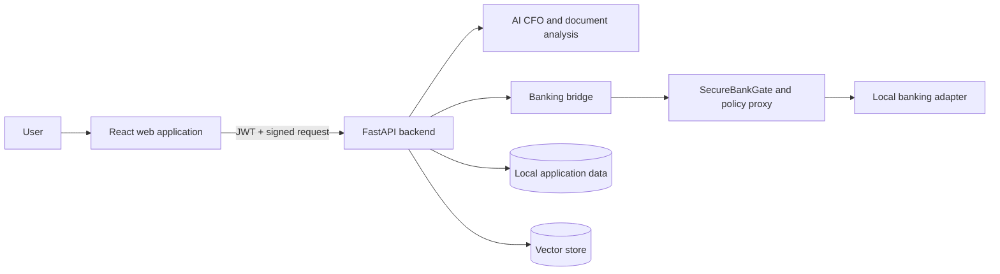
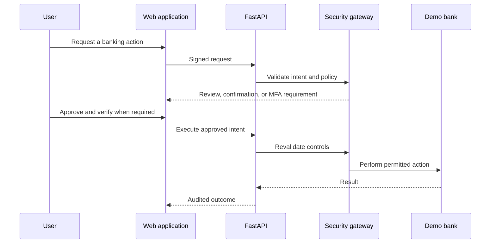

# FINN

> An AI-powered financial workspace with secure, policy-controlled banking operations for small and medium-sized businesses.

[](app/)
[](web-app/)
[](banking-agent/)

FINN brings document analysis, financial reporting, AI-assisted CFO
conversations, and a local banking sandbox into one development environment.
It is designed around a simple security principle: a conversation may propose a
financial action, but policy controls—not natural-language output—decide
whether it can proceed.

> **Development environment only.** This repository contains demonstration
> services and sample workflows. Do not use it with real funds, customer data,
> production credentials, or as a production banking integration.

## Highlights

- Upload and analyse financial documents.
- Generate financial reports and ask the AI CFO follow-up questions.
- Prepare bank transfers through a guided review flow.
- Apply signed requests, transaction intent checks, approval thresholds,
  multi-factor authentication, audit logging, and a kill switch to banking
  operations.
- Run with a local AI mode or an AWS Bedrock-backed configuration.

## Architecture



### Secure banking flow



## Banking security model

Banking requests are deliberately separated from chat responses. The system
does not move money because a model produced text suggesting it should; it
requires a signed, validated operation that satisfies the applicable policy.

| Level | Typical operation | Control |
|---|---|---|
| Green | Read-only balances, transaction history, analysis | Execute after validation |
| Yellow | Lower-risk payment or subscription action | Explicit user confirmation |
| Red | Higher-value payment, sensitive card action, investment action | Strong verification and confirmation |

The banking layer validates the request signature, timestamp, client identity,
transaction intent, spending and approval rules before it reaches the selected
bank adapter. Every material outcome is recorded in the audit trail.

## Demo password recovery

The sign-in screen includes a password recovery demo. In the development
environment, a six-digit, five-minute code is printed in the backend terminal;
the code is never returned to the browser. Codes allow up to three attempts,
and new requests for the same email are rate-limited for 60 seconds. Challenges
are kept in process memory, so restarting the backend invalidates them.

This is not a production recovery channel: the flow is disabled outside the
development environment and no SMS provider is configured. A production rollout
must deliver codes to a verified recovery phone number through an SMS provider,
use shared, persistent challenge storage appropriate to the deployment, and
revoke existing sessions after a successful password change.

## Technology

| Layer | Technology |
|---|---|
| API | FastAPI and Python |
| Web application | React and Vite |
| Banking controls | SecureBankGate, policy proxy, signed requests, MFA and audit records |
| AI | Local mode or AWS Bedrock |
| Local services | SQLite-backed application data and a local demonstration banking API |

## Prerequisites

- Python 3.11 or later
- Node.js 20 or later
- npm
- Git
- Optional: AWS credentials and Bedrock model access when using AWS mode
- Optional: Ollama when using local AI mode

Check your installed tools:

```powershell
python --version
node --version
npm --version
```

## Setup

Run all commands from the repository root unless noted otherwise.

### 1. Backend

```powershell
python -m venv .venv
.\.venv\Scripts\Activate.ps1
python -m pip install --upgrade pip
pip install -r requirements.txt
Copy-Item app\.env.example app\.env
```

Update `app/.env` for your local environment. A minimal local configuration is:

```dotenv
APP_ENV=development
DEBUG=true
SECRET_KEY=replace-with-a-long-local-secret
JWT_EXPIRATION_HOURS=24
PROCESSING_MODE=local
API_HOST=127.0.0.1
API_PORT=8000
```

### 2. Banking security layer

```powershell
Set-Location banking-agent
python -m venv .venv
.\.venv\Scripts\Activate.ps1
python -m pip install --upgrade pip
pip install -r requirements.txt
Set-Location ..
```

### 3. Web application

```powershell
Set-Location web-app
npm install
Set-Location ..
```

Create `web-app/.env` when needed:

```dotenv
VITE_API_BASE_URL=http://127.0.0.1:8000
```

### 4. Demonstration banking API

```powershell
Set-Location postman-demo
npm install
Set-Location ..
```

Create `postman-demo/.env` from its example file and use local development
values only. Never commit an active credential.

## Run locally

Start each service in a separate PowerShell window.

### Demonstration banking API

```powershell
Set-Location postman-demo
npm run dev:api
```

### Backend API

```powershell
.\.venv\Scripts\Activate.ps1
$env:KEY_PASSPHRASE="choose-a-local-passphrase"
python -m uvicorn app.main:app --host 127.0.0.1 --port 8000 --reload
```

### Web application

```powershell
Set-Location web-app
npm run dev -- --host 127.0.0.1
```

Open `http://127.0.0.1:5173` in a browser. The backend API documentation is
available at `http://127.0.0.1:8000/docs`.

## Using the banking workflow

1. Sign in to the web application.
2. Start a transfer from the Banking page or through the chat-assisted flow.
3. Select a source account and review the proposed details.
4. Complete confirmation and, where required, MFA or an approval step.
5. Execute the prepared operation and review the resulting audit status.

Natural-language input can initiate a request, but it cannot bypass the review,
confirmation, verification, or policy steps.

## Validation

### Web production build

```powershell
Set-Location web-app
npm run build
```

### Banking security tests

```powershell
Set-Location banking-agent
.\.venv\Scripts\python.exe -m pytest -q
```

### Local service checks

```powershell
Invoke-WebRequest http://127.0.0.1:3000/health -UseBasicParsing
Invoke-WebRequest http://127.0.0.1:8000/docs -UseBasicParsing
Invoke-WebRequest http://127.0.0.1:5173 -UseBasicParsing
```

## Project structure

```text
.
├── app/                 # FastAPI application, services, and API routes
├── banking-agent/       # Security gateway, policy configuration, and bank adapters
├── web-app/             # FINN React and Vite web application
├── postman-demo/        # Local demonstration banking API workspace
├── data/                # Local development data
├── uploads/             # Local uploaded documents
├── scripts/             # Development and maintenance utilities
└── requirements.txt     # Python dependencies
```

## Configuration and security

- Start from the supplied environment-file templates; do not hard-code secrets.
- Keep credentials, signing keys, uploaded documents, and local data out of
  source control.
- Do not disable request signing, policy checks, approval rules, or the kill
  switch for convenience.
- Treat all local MFA codes and demonstration bank responses as test-only.
- Production adoption requires HTTPS, managed identity, secret rotation,
  durable audit storage, monitoring, backup and recovery, regulatory controls,
  and an independently reviewed banking integration.

## License

Review this repository and all upstream component licenses before redistribution.
